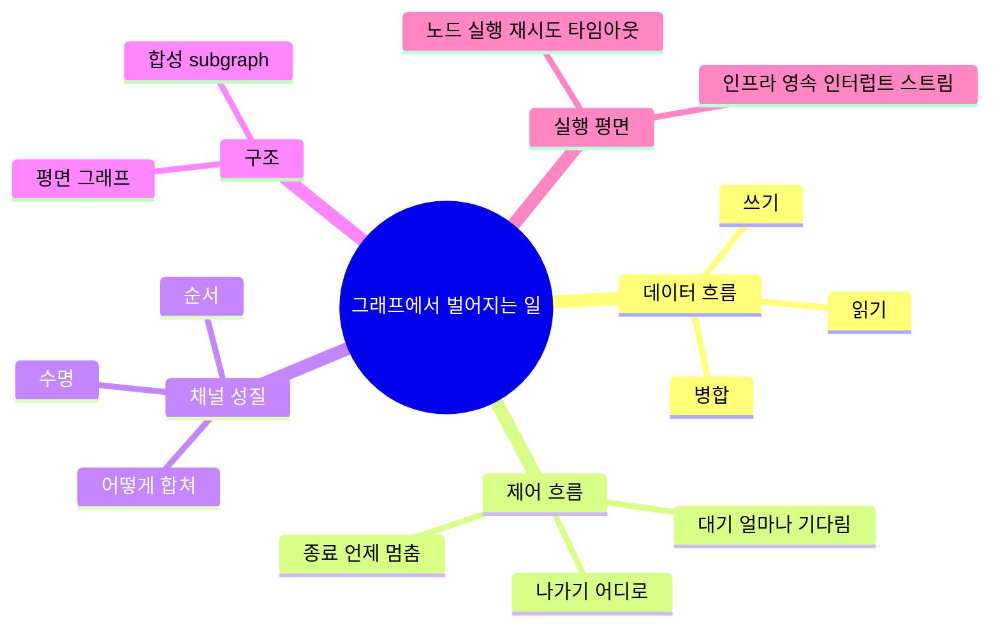

# 그래프 제어/데이터 흐름 — 전체 분류와 우리 좌표

Vn 단계 노트가 아니라 **개념 지도**다. "우리 그래프 엔진에서 벌어질 수 있는 일"을 독립 이진 차원들의 곱으로 분류하고, V4가 어디까지 왔는지(❌ 칸이 곧 로드맵)를 한 장에 박제한다. V5~V7 진행 시 체크리스트로 쓴다.

## 큰 그림: 두 축은 "같은 엣지의 양면"

- **나가기(제어 흐름):** 이 노드가 **다음에 누구에게** 보내나 → 엔진/스케줄링(`stream` 루프).
- **들어오기(상태 병합):** 이 노드로 **누구에게서** 오나 → 채널/리듀서(`applyWrites`).

팬아웃(N개로 보냄)의 도착지가 곧 팬인(N개서 받음)이라, 둘은 같은 엣지를 보내는 쪽/받는 쪽에서 본 것이다.

---

## 카테고리 1 · 나가기 = 10

차원: **[갯수 1/N] · [정적/동적] · [전부/선택] · [순환/비순환]**
정적·동적·전부·선택은 **N일 때만** 의미 → `1→1`은 순환 차원만.

### 1→1 (2)
| 순환 | 패턴 | 우리 | 단계 |
|---|---|---|---|
| 비순환 | 순차 체인 `a→b` | ✅ | V1 |
| 순환 | 단순 루프 `a→b→a` | ⚠️ 무한(탈출 조건 없음→limit) | 실용은 V5 |

### 1→N (2×2×2 = 8) — 순환 빼고 핵심 4조합
| 정적/동적 ＼ 전부/선택 | 전부(all) | 선택(selective) |
|---|---|---|
| 정적 | `a→{b,c}` 둘 다 — 팬아웃 ✅ **V4** | router가 {b,c} 중 택 — 조건분기 ❌ **V5** |
| 동적 | `Send`로 리스트 전체 map ❌ **V6** | `Send`로 런타임 부분집합 map ❌ **V6** |

각 칸 × [순환/비순환] = 8. (정적·선택·순환 = `while(조건)` 루프 = V5의 실용 루프. 동적·순환은 드묾.)

**합계 2 + 8 = 10.**

---

## 카테고리 2 · 들어오기 = 5

차원: **[갯수 1/N] · [합치기 덮어쓰기/리듀서] · [대기 기다림/즉시]**
대기는 **N→1일 때만** 의미.

### 1→1 (2)
| 합치기 | 패턴 | 우리 |
|---|---|---|
| 덮어쓰기 | `LastValue` 단일 쓰기 | ✅ |
| 리듀서 | 단일 쓰기 seed/누적(루프 시 스텝 간 축적) | ✅ |

### N→1 (2×2, 그중 1칸 모순)
| 합치기 ＼ 대기 | 즉시(하나 오면 감) | 기다림(다 올 때까지) |
|---|---|---|
| 리듀서 | 우리 현재: 정렬✅ / 어긋나면 **중복 실행**⚠️ **V4** | **진짜 join** ❌ **V7 NamedBarrierValue** |
| 덮어쓰기 | 같은 스텝 2쓰기 → **InvalidUpdateError**(에러로 방지) ✅ | ✗ 모순(기다렸다 하나만 남김?) — 안 씀 |

**유효 = 1→1의 2 + N→1의 3 = 5.** (모순 칸 제외)

어긋난 팬인은 실패 테스트로 확인: [`test/staggered-fanin.test.ts`](../../packages/core/test/staggered-fanin.test.ts) — `d`가 두 번 실행, log 끝 `…d,e,d`. Studio 예제 `staggered`로도 관찰.

---

## 완전성 점검 — 위 두 축이 다인가? (아니다)

두 축은 "흐름(routing+merge)"은 빈틈없이 덮지만, 넓히면 세 종류의 누락이 있다.

### A. 두 축 **안**의 숨은 서브차원
- **순서 의존(교환법칙):** 비가환 리듀서(리스트 concat 등)는 **fold 순서가 결과를 바꾼다**. → [`pregel.ts`의 `names.sort()`](../../packages/core/src/pregel.ts)로 순서 고정. ⇒ 합치기 = [어떻게] × [순서].
- **수명(persist vs ephemeral):** {덮어쓰기, 리듀서}는 둘 다 "유지". **한 스텝만 살고 사라지는** 채널(`EphemeralValue`, 트리거/신호용)이 빠짐. ⇒ 합치기 = [어떻게] × [순서] × [수명]. (V7 트리거 채널)
- **대기는 2값이 아님:** 즉시(first) / K-of-N(정족수) / named-all. `NamedBarrierValue`는 셋째, 우리 현재는 첫째.

### B. 두 축 **밖**의 방향 (카테고리 자체 누락)
- **종료:** "어디로 보내나" 말고 **"언제 멈추나"**. 정상 종료(활성 소진·`→END`) / 스텝 한도(`limit=100`) / **조건부 조기 종료**(V5 필요). ← 제3의 제어 질문.
- **읽기:** 데이터 흐름의 세 번째 방향. 우리 엔진은 [전체 스냅샷을 다 읽어](../../packages/core/src/pregel.ts) 이 축을 숨겼을 뿐, 일반적으론 노드가 특정 채널만 구독. ⇒ 데이터 흐름 = 읽기/쓰기/병합.
- **엣지가 데이터를 싣나:** 우리는 엣지=제어만, 데이터=공유 채널. `Send(node, payload)`는 페이로드 동반(메시지 패싱). `Command(goto+update)`는 나가기+상태를 노드 안에서 합침. (V6/V7)
- **합성(subgraph):** 노드가 통째로 하위 그래프. 완전히 빠짐.

### C. 다른 평면 (위상이 아니라 실행/인프라 — 대부분 의도적 범위 밖)
- **노드 실행:** 순수 vs 부수효과, 성공 vs **실패→재시도**, **타임아웃**, sync/async. (우린 async 하나만)
- **인프라:** 영속성·재개, 인터럽트, 스트리밍(← `stream`이 유일하게 가짐), 진짜 병렬성.

---

## 완전한 지도



```
데이터 흐름  ─ 읽기 / 쓰기 / 병합            ← 우리는 쓰기·병합만 (읽기 숨김)
제어 흐름    ─ 나가기 / 종료 / 대기           ← 종료가 빠졌던 축
채널 성질    ─ [어떻게] × [순서] × [수명]      ← 순서·수명 서브차원
구조         ─ 평면 / 합성(subgraph)
────────────────────────────  (여기까지 "그래프 모양")
실행 평면    ─ 노드 실행 / 인프라              ← 대부분 의도적 범위 밖
```

## 우리 V4 좌표

```
나가기:   [1/N ✅] · [정적 ✅ / 동적 ❌] · [전부 ✅ / 선택 ❌] · [비순환 ✅ / 순환 ⚠️]
들어오기: [1/N ✅] · [덮어쓰기 ✅ / 리듀서 ✅]                · [즉시 ✅ / 대기 ❌]
```

**한 줄: V4 = "정적·전부·즉시"만 되는 엔진.** "합치기(채널)"는 V3에서 거의 완성, 남은 ❌는 전부 **제어 흐름** 쪽.

## 로드맵 매핑 (❌ 칸을 켜는 순서)
- **V5 · 조건부 엣지:** 나가기 [선택], 종료 [조기], 나가기 [순환→실용 루프].
- **V6 · Send:** 나가기 [동적], 엣지 [페이로드].
- **V7 · Command + compile 정합:** 들어오기 [대기]=`NamedBarrierValue`, 채널 [수명]=`EphemeralValue`, 엣지 [Command]. 제어 흐름을 채널 쓰기로 낮춰 통일.
- **범위 밖(이 프로젝트 안 함):** 합성(subgraph), 노드 재시도/타임아웃, 영속성, 인터럽트.

## 참조
- langgraph: `pregel/_read.py`(PregelNode·ChannelRead), `pregel/_write.py`(ChannelWrite), `graph/state.py`(attach_edge/attach_branch), `channels/{ephemeral_value,named_barrier_value,topic}.py`.
- 우리: [`pregel.ts`](../../packages/core/src/pregel.ts), [`stateGraph.ts`](../../packages/core/src/stateGraph.ts), [`07-v4-superstep.md`](07-v4-superstep.md).
